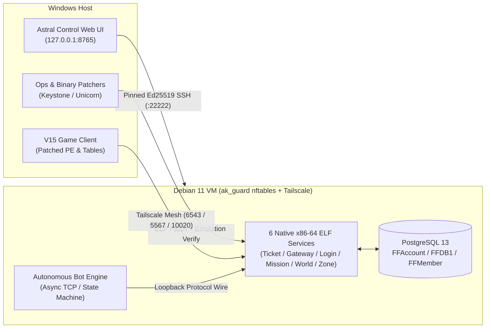

# Azuria at Home (`azuria-at-home`)

> *"Mom: 'We have Azuria at home.'"*  
> **Azuria at home:** A reverse-engineered C++ MMORPG control plane featuring Unicorn-verified x86-64 ELF binary hooks, a 19,649-item free-to-play SQL economy, a zero-dependency web administration console, and async TCP Python bots pretending to be human party members.

---

## Overview

**Azuria at Home** is a systems engineering, binary instrumentation, and autonomous agent toolkit built to host, modernize, and automate a legacy 2014 Linux x86-64 C++/PostgreSQL MMORPG server inside a local Debian 11 VM over a zero-trust Tailscale mesh.

Rather than modifying source code (which does not exist), this project instruments compiled stripped/DWARF ELF binaries directly using **Keystone/Capstone** assembly patches verified under **Unicorn CPU emulation**, rewrites the cross-database microtransaction billing layer into an in-game gold economy, and provides headless **asyncio TCP bot companions** capable of questing, combat, party assist, and boss telegraph evasion.



---

## Key Engineering Highlights

### 1. x86-64 ELF Binary Instrumentation & Unicorn CPU Emulation (`ops/`)
All binary modifications are assembled with **Keystone**, disassembled with **Capstone**, and validated pre-deployment against a **Unicorn Engine** x86-64 CPU test harness to verify System V AMD64 ABI register preservation, stack alignment, and edge-case control flow:

- **Live In-Memory Item Mall Gold Debit Hook ([ops/build-mall-debit-hook.py](ops/build-mall-debit-hook.py), [ops/verify-mall-debit-hook.py](ops/verify-mall-debit-hook.py)):**
  - *Problem:* Standard SQL cash-shop stored procedures debit gold in PostgreSQL, but an online character's gold resides in `ZoneServer` memory (`CCharacter+0x2714`) and overwrites the database on logout (`SavePlayerCharacter`).
  - *Solution:* Injected an x86-64 code cave at `0x16cb000` and a 256 KB `u32` unit-price lookup table at `0x16d0000` into `ZoneServer`, hooking `CNE_ZW_ZoneServerItemMallReceieveAttempt::Execute` (`0x7c787f`, `0x7c7f10`) to invoke native `CCharacter::GainCoins` (`0xa000f0`) in real time before chaining into the enhancement hook. Verified across 16 emulated execution scenarios.
- **Auto-+30 Fortification & 5-Star Evolution Hook ([ops/patch-mall-enhancement.py](ops/patch-mall-enhancement.py), [ops/verify-mall-enhancement-hook.py](ops/verify-mall-enhancement-hook.py)):**
  - Post-create item delivery hook invoking `AddStrengthenToItem`, native 5-star evolution, attribute recalculation, and live client packet notification (`18/18` Unicorn test cases).
- **Modern Tunnel `getifaddrs` Null-Pointer Guard ([ops/patch-null-ifaddrs.py](ops/patch-null-ifaddrs.py)):**
  - Patched `WorldServer` and `ZoneServer` interface enumeration loops to guard against null `ifa_addr` entries exposed by Linux `tun`/`tailscale0` interfaces.
- **32-Bit Damage & HP Clamp Expansion ([ops/build-damage-cap-patch.py](ops/build-damage-cap-patch.py), [ops/verify-damage-cap-patch.py](ops/verify-damage-cap-patch.py)):**
  - Identified all 26 `99,999,999` (`0x05F5E0FF`) immediate constants in `ZoneServer .text`, patching the 21 genuine formula clamp sites (`CCharFormula::Attack`, `MeleeDamage`, `MagicDamge`, `MaxHP`, `CEudemonBattleFormula::GetMaxHP`) to `INT32_MAX` (`0x7FFFFFFF`) while leaving coupled subtraction constants in archaeology/fishing untouched (`18/18` Unicorn test cases).

### 2. Reverse-Engineered F2P Economy (`ops/install-full-mall.py`)
- Replaced the pay-to-win microtransaction shop with a **19,649-item**, **43-category** catalog ([docs/mall-f2p-catalog.json](docs/mall-f2p-catalog.json)) cross-checked for client/server schema compatibility (`S_Item` ↔ `C_Item`).
- Rewrote `FFMember` PL/pgSQL billing (`get_point_info`, `req_buy_item`) using PostgreSQL `dblink` to resolve active characters and price items dynamically in earned **Gold** (`money_unit = 1`) and **Bind Gold** (`money_unit = 2`).
- Extended the client PE binary (`game.bin`) category label builder vector and repointed UI imageset coordinates to display native Gold/Silver coin icons in place of cash-shop points.

### 3. Autonomous Asyncio TCP Bot Companions (`bots/`)
A headless Python client and gameplay state machine that speaks the native encrypted TCP wire protocol (`TicketServer` → `LoginServer` → `GatewayServer` → `WorldServer` → `ZoneServer`):
- **Combat & Party Assist ([bots/combat.py](bots/combat.py), [bots/assist.py](bots/assist.py), [bots/battle.py](bots/battle.py)):** Target validation, spell rotation, cooldown tracking, and leader-target synchronization.
- **Boss Telegraph Evasion ([bots/evasion.py](bots/evasion.py), [bots/encounter_learning.py](bots/encounter_learning.py)):** Parses enemy skill cast packets and repositions bots outside AoE danger geometry.
- **Navigation & Questing ([bots/navigation.py](bots/navigation.py), [bots/quest_engine.py](bots/quest_engine.py), [bots/movement.py](bots/movement.py)):** Scene grid pathing, portal traversal, NPC dialogue sessions, and automated death/respawn recovery.
- **Isolated Network Namespace Sandbox ([bots/lab.py](bots/lab.py)):** Runs untrusted protocol experiments inside an isolated `unshare --pid --net --mount` container with ephemeral database snapshots before promoting bots to the live world.

### 4. Astral Control Web Plane (`dashboard/`)
A zero-dependency local web administration console ([dashboard/server.py](dashboard/server.py), [dashboard/agent.py](dashboard/agent.py)) bound strictly to `127.0.0.1:8765`:
- **Live Telemetry & Bot Controls:** Monitor all 6 server daemons, inspect live bot heartbeats/tasks/events, and start/stop bot companions.
- **Safe Offline Mutations:** Enforces dual `quit` state checks (`online == 0`) and takes automatic `pg_dump -Fc` snapshots before modifying character levels, gold, privileges, or Item Mall stock.
- **Scheduled Sales with Crash Recovery:** Background scheduler applies category discounts and persists original-price snapshots to SQLite before mutating PostgreSQL, guaranteeing automatic price restoration even if interrupted.
- **Hardened Local Security:** PBKDF2-HMAC-SHA256 authentication, rate-limited login, `SameSite=Strict` session cookies, strict `Host`/`Origin`/CSRF token verification, and pinned Ed25519 SSH host keys.

---

## Repository Structure

```text
├── bots/                  # Asyncio TCP bot client, combat/evasion AI, protocol definitions & unit tests
├── dashboard/             # Astral Control web server (127.0.0.1:8765), guest agent, UI & test suite
├── ops/                   # ELF binary patchers, Unicorn CPU verifiers, SQL/client deployment & firewall
├── vendor/AKF/            # Hardened Linux server installer & service manager (forked from MrDulgan/AKF)
├── docs/                  # Architecture notes, patch manifests, item catalogs & rebuild runbook
├── Start Dashboard.cmd    # Launches the local Astral Control web console
├── Start Server.cmd       # Boots the headless VirtualBox VM and starts game services
└── START-HERE.md          # Quick-start operator instructions
```

---

## Running Verification Suites

You can run the Unicorn CPU emulation hook verifiers and unit test suites directly on Windows or Linux without a running game server:

```powershell
# 1. Verify ZoneServer Mall Gold-Debit Hook (16 Unicorn x86-64 emulation scenarios)
python ops/verify-mall-debit-hook.py

# 2. Verify ZoneServer +30 / 5-Star Delivery Hook (18 Unicorn x86-64 emulation scenarios)
python ops/verify-mall-enhancement-hook.py

# 3. Run Dashboard Security, Scheduler & SQL Guard Tests
python -m unittest discover -s dashboard -p "test_dashboard.py" -v

# 4. Run Bot Protocol, Assist, Evasion & Recovery Unit Tests
python bots/tests/test_assist.py
python bots/tests/test_evasion.py
python bots/tests/test_recovery.py
```

For full VM provisioning and server installation from base archives, see **[docs/REBUILD-FROM-SCRATCH.md](docs/REBUILD-FROM-SCRATCH.md)**.

---

## Credits & Disclaimer

- Base shell installer under `vendor/AKF/` adapted from [MrDulgan/AKF](https://github.com/MrDulgan/AKF) (`b1b5f59`), hardened with static-binary `ldd` handling, executable permission preservation, and strict `nftables` Tailscale firewall enforcement.

> **Legal & Educational Disclaimer:**  
> *This repository contains **only** original control-plane software, assembly patch generators, CPU emulation test harnesses, and network protocol research created for educational, preservation, and interoperability purposes. It contains **no** proprietary game binaries, server executables, database dumps, or copyrighted client assets. Not affiliated with or endorsed by X-Legend Entertainment or Aeria Games.*
