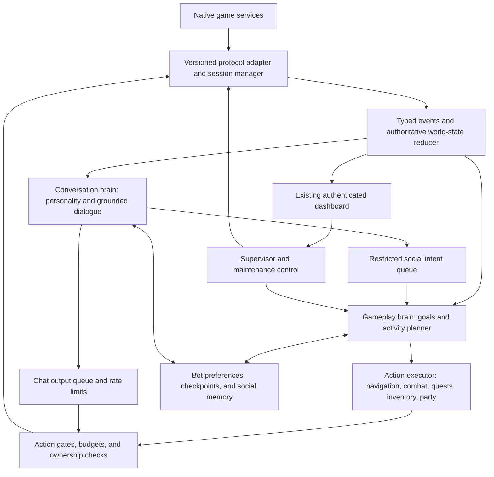

# Aura Kingdom Persistent Player Bots

## Technical design, product direction, and implementation handover

**Prepared:** 27 October 2026, Asia/Jakarta  
**Project:** `D:\Games\Aura Kingdom Private Server`  
**Status:** proposed architecture built around a partially working native-protocol prototype  
**Audience:** the next planning/implementation agent and the server owner

> This document deliberately separates demonstrated behavior from proposed behavior. The prototype is not yet a reliable autonomous player. Read the implementation snapshot and blockers before planning features or starting services.

**28 October update:** a local encounter recorder and gated supervised shadow
trainer have since been implemented. Participant-aware real fight recording and
a nine-minute connection check passed. Active learned decisions remain disabled.
See [the encounter-learning implementation notes](ENCOUNTER-LEARNING.md) for the
current behavior and remaining validation; the historical snapshot below is
retained as handover context.

---

## 1. Product goal: make the world feel inhabited

Build persistent, recognizable adventurers who actually play on the owner's private Aura Kingdom server. They should develop alongside human players, accumulate their own history and equipment, and make a small private MMO feel like a living community.

The long-term goal is more ambitious than a character that runs between waypoints. A bot should be able to wake up in town, choose a useful activity, prepare its equipment and supplies, travel, progress quests, fight competently, loot, improve its build, join companions, recover from trouble, and talk about what actually happened. Its next login should continue the same life rather than reset a demonstration.

Examples of the desired experience:

- Awan finishes a delivery, replaces a weak weapon with an earned upgrade, and hunts enemies appropriate to his new level when the next quest is unsupported.
- Arden accepts a human's party invitation, follows the current leader, survives normal travel, assists when appropriate, and resumes his own progression after leaving the party.
- A healer notices the tank is under pressure and heals before making another attack. A tank maintains a useful position instead of chasing every nearby creature.
- A companion who falls behind continues toward updated party positions. A blocked waypoint causes a new plan, not permanent silence or a logout.
- A bot remembers a recent dungeon run and mentions it naturally later, without fabricating rewards or claiming to have completed content it never entered.
- A small group plans a supported dungeon, enters through the normal game flow, completes mechanics, distributes ordinary rewards, and exits safely.
- The owner can inspect why a bot is doing something, pause it, change its role, and understand its limitations from the dashboard.

These must be **ordinary player characters controlled through normal game connections**, not decorative NPCs pretending to make progress. Real quests, rewards, character persistence, combat restrictions, and inventory ownership remain authoritative on the game server.

### 1.1 Desired scale

Start with **two useful, reliable bots**. Grow to twelve only after the core loop is dependable. Treat larger populations as a later capacity and content milestone, not a configuration change that makes an unreliable prototype reliable.

Long-term population behavior can include different classes, roles, schedules, preferences, friendships, and group activities. Never equate twelve connected accounts with twelve working adventurers.

### 1.2 The owner's preferred gameplay model

The owner explicitly wants a practical, deterministic approach:

1. Accept a quest.
2. Determine its real objective.
3. Navigate to the objective.
4. Talk, fight, gather, use an item, or perform the required interaction.
5. Observe authoritative completion.
6. Return and claim the reward.
7. Equip improvements and choose the next activity.

Aura Kingdom's ordinary client provides objective clicks and autowalk. Investigate reusable native navigation information, but do not assume a packet named `MissionGoto` is autowalk: earlier inspection found item/transport checks. The owner does **not** want machine learning, learned barrier navigation, or an elaborate chat system to become prerequisites for basic questing.

---

## 2. Latest requirements and priorities

These requests remain relevant to the next plan:

| Requirement | Intended behavior |
|---|---|
| Headless operation | Run inside the Linux VM without graphical game clients. |
| Normal shared world | Humans and bots play in the same normal world. Do not switch the owner to an isolated world. |
| Real progression | Quests, combat, rewards, XP, equipment, and persistence use supported player actions. |
| Quest fallback | If a quest cannot be performed, preserve it and choose productive supported activity. |
| Stronger enemies | As level and capability improve, seek more suitable enemies instead of farming the same starter rabbit forever. |
| Equipment | Both Awan and Arden should equip usable improvements they own or obtain normally. |
| Skills | Both bots should use their actual learned skills, respecting cooldowns and prerequisites. |
| Death recovery | Respawn and resume or recover; dying must not terminate the process. |
| Arden companion | Accept ordinary invitations, follow the current party leader, and make occasional small talk. |
| Following | Keep tracking the leader after visual separation and replan around blocked terrain. |
| Chat | Separate the conversational brain from the gameplay loop. Keep personality and dialogue grounded in real events. |
| Visibility | Bots must be visible ordinary characters, not merely names in chat. |
| Observability | Bot and server logs appear newest first in the existing dashboard. |
| Safe maintenance | Stop, pause, drain, restart, and resume bots without disrupting humans or reconnecting during maintenance. |

**Priority order:** connection reliability and truthful state → survival/combat → equipment/loot → continuous progression → reliable companionship → richer conversation → population and dungeon breadth.

Chat can ship early as a small independent feature. It must not block these priorities.

### 2.1 Important historical exception

The owner explicitly authorized completing the bots' tutorial through the database and moving them to the first normal map because the tutorial prototype was taking too long. That administrative bootstrap has already happened. It is **not** evidence that the bots autonomously completed the tutorial, and it is not blanket authorization to mark future quests complete or grant progression whenever the runtime struggles.

---

## 3. Implementation snapshot: what actually exists

### 3.1 Current environment

| Component | Current arrangement |
|---|---|
| Host | Windows PC; local workspace on drive D. |
| Game runtime | Linux VM, Debian 11 baseline, approximately 4 virtual CPUs and 4 GB RAM in the inspected setup. Recheck before capacity planning. |
| Game build | V15 family; login probe uses version string `015.001.01.16`. This is not current official-game parity. |
| Game installation | `/root/hxsy` in the VM. |
| Databases | PostgreSQL 13; `FFAccount`, `FFDB1`, `FFMember`. |
| Networking | VM NAT and private Tailscale connectivity. SSH is forwarded to Windows localhost port `22222`. |
| Bot implementation | Python, `asyncio`, native game protocol; Linux runtime observed as Python 3.9. |
| Deployment code | `/opt/ak-bot-prototype` in the VM. |
| Runtime identity | Dedicated unprivileged Linux user `akbots`; bot units use `NoNewPrivileges=yes`. |
| Dashboard | Existing Windows-hosted dashboard at `http://127.0.0.1:8765/#bots`. |
| Bot telemetry | Private per-bot JSON status plus bounded JSONL public event feeds. |
| Boot integration | Experimental transient units; production bot autostart has not been validated or enabled as a completed feature. |

Game-service endpoints used by the prototype are LoginServer `6543`, WorldServer `5567`, and ZoneServer `10020`. World/Zone connections currently address the VM's Tailscale IPv4 while binding the local connection source to loopback. Do not turn this into a new public administration endpoint.

### 3.2 Bot identities

| Bot | Ordinary account | Character ID | Private state | Role |
|---|---|---:|---|---|
| Awan | `awanbot` | `50000002` | `/var/lib/ak-bots/pilot` | Quest prototype and fallback hunter. |
| Arden | `ardenbot` | `50000003` | `/var/lib/ak-bots/arden` | Requested party companion; also intended to progress independently. |

Both currently use Sword-and-Shield starter characters. The original twelve-bot class distribution is a future population design, not today's deployed state.

Credentials are random, private, and excluded from this document. Do not publish identity files, session tickets, dashboard credentials, SSH keys, or raw authentication traffic.

The owner's human character, **Zrymund**, has heavily boosted statistics and movement. Do not control or copy that character. Its performance is not a valid ordinary-bot combat benchmark.

### 3.3 Demonstrated behavior

| Capability | Evidence and boundary |
|---|---|
| Authentication | Native Login → World → Zone flow works. |
| Character creation | Ordinary accounts and characters were provisioned/created; runtime verifies the configured character name before control. |
| Shared world | Awan appeared to the human player in Port Skandia; the owner supplied a screenshot. |
| Movement | Native movement segments, collision data, self-position acknowledgments, and correction handling have been exercised. |
| Early questing | Awan completed quests `1004–1009` using ordinary dialogue, deliveries, combat, gathering, and reward claims. |
| Combat | Native melee damage, monster deaths, XP progression, and some loot were observed. |
| Gathering | Gather skill `62033` worked on authored wood piles for quest `1009`. |
| Quest fallback | Unsupported quest `1010` was preserved while Awan switched to ordinary rabbit hunting. |
| Starter weapon | Both Awan and Arden bought item `10001` from the ordinary weapon merchant and received native equipment-transfer success. |
| Initial armor | Starter chest, gloves, and boots were already equipped. A base appearance that looks like underwear is not sufficient evidence of zero equipped armor. |
| Respawn | The original death-handler crash was fixed; native respawn confirmation and resumed hunting were observed. |
| Chat | Scripted local English/Indonesian messages were echoed by the server and seen by the owner. |
| Party join | After correcting the accept-result field, the owner confirmed Arden joins a party. |
| Short-range follow | The owner confirmed Arden follows initially, but reported stopping when the leader moves away quickly. |
| Dashboard | Authenticated bot monitoring and descending bot/server logs exist. |

Arden also completed the introductory dialogue/delivery sequence through `1007` to earn enough money for his starter weapon. No administrative gear grant was needed for that purchase.

### 3.4 Not complete, even if code exists

- Reliable sessions beyond the recurring WorldServer idle kick.
- Continuous general quest solving beyond the small verified chain.
- Quest-item use on the sleeping workers in quest `1010`.
- Automatic gear comparison and equipping of arbitrary upgrades.
- A verified automatic combat-skill rotation.
- Enemy selection that advances with level and capability.
- Independent progression for Arden when not in a party.
- Robust following after visual separation, arbitrary terrain failures, and map transitions.
- Validated leader changes, party restoration after reconnect, and full-party edge cases.
- Combat assistance, tank/healer roles, or a proven party dungeon run.
- A completed bot supervisor, maintenance drain, population controls, or twelve-bot soak test.
- A conversational model or independent conversational service. Today's chat is templates.

Do not describe these as implemented simply because a function, optional flag, or packet codec has been drafted.

### 3.5 State at handover

The last successful VM inspection found both transient bot units inactive after recurring disconnects. Normal game services were active at that inspection. A later SSH attempt to localhost port `22222` failed, so **the VM's current availability was not reverified**. Do not infer a VM crash or start/restart the VM without inspecting its actual state.

The latest user request changed the immediate task to this design/handover. Several local code changes are in progress; there is no clean committed release or complete latest test result. The workspace is not a Git repository in the inspected state.

---

## 4. Immediate blockers the next agent should resolve first

### 4.1 Confirmed recurring WorldServer idle kick

This is the most important runtime blocker. The bots repeatedly disconnected after roughly six minutes, even while fighting or chatting.

The useful evidence is in **current `System*` logs**, not only `Test*` logs:

- WorldServer: `CEventIdleKickout` and `idles too long, kickout!`.
- ZoneServer: Awan/Arden `kickout by worldserver(2)!`.
- Root-only read-only inspection showed healthy ZoneServer ping counters immediately before some failures. A working Zone ping is not proof of a healthy World connection.

The prototype keeps Login and World TCP connections open while awaiting the Zone session. Closing them after Zone loading was tested and immediately kicked the bot, so that attempted fix was reverted.

The current background helper uses **`CNC_CW_ServerHello`**. Its observed native identifier is `0`, which also overlaps a text-command family in the symbol inventory. A distinct command has now been identified:

| Native command | Observed identifier | Status |
|---|---:|---|
| `CNC_CW_ServerKeepAlive` | `2` | Identified, not yet integrated or live-validated. |
| `CNC_CW_ServerHello` | `0` | Currently used by the prototype helper; it has not prevented idle kicks. |

Relevant static addresses for the **currently inspected WorldServer binary only**:

- `CNC_CW_ServerKeepAlive::Deserialize`: `0x527920`.
- `CNE_CW_ServerKeepAlive::Execute`: `0x53b0a0`.
- `CEventIdleKickout::Execute`: `0x4be2d0`.

The last attempt to inspect the KeepAlive body failed because SSH was unreachable. **Verify its payload and effect before sending it. Do not assume it is empty because Hello is empty.** Packet identifiers and addresses must be resolved against the installed build, not treated as universal protocol constants.

Also inspect `ServerPlayerState` and the normal post-handoff lifecycle if KeepAlive alone does not resolve the issue. Do not extend or disable game-server idle timeouts to conceal a missing client behavior.

Acceptance: a bot performs ordinary gameplay for at least thirty minutes, survives multiple idle-check periods, and the relevant native connections remain valid without world kickouts. Then run a longer mixed-activity soak.

### 4.2 Death handling: repaired, but survival is unfinished

The original immediate failure was a Python name-shadowing bug: an unpacked death-packet field named `revive` replaced an async function of the same name, causing an integer-not-callable exception. The function is now `request_revive`; the packet field is `revive_kind`.

Current behavior:

1. Recognize the bot's own death.
2. Suspend the activity task rather than continuing a stale fight.
3. Send the normal native revive request.
4. Wait for the server's revive notification.
5. Allow a recovery delay, then restart/replan the activity.
6. Pause combat after repeated deaths while keeping the character connected.

Native respawn and subsequent hunting were observed. This does not solve bad target selection, missing healing, insufficient DPS, or all stale-state problems after respawn. Add potion use, resting, threat assessment, and sensible retreat before advertising unattended survival.

### 4.3 Arden's party response: corrected and human-confirmed

The first implementation copied the invitation notice's first short into the response. Real notice metadata was `[3, 1, 0]`. In the response, `3` means a busy/unavailable result; acceptance requires **`0`**.

The corrected reply layout is:

```text
int16 response_result = 0
uint32 inviter_character_id
int16 team_kind
int16 accept_boolean = 1
```

The owner then confirmed Arden joins. A regression fixture was added for this real notice. This is an example of why tests that mirror an unverified packet assumption can pass while the feature remains broken.

### 4.4 Following stops on a navigation failure

The owner initially attributed this to moving too fast. Logs showed a concrete additional problem: `No collision-safe cell near target` caused the companion worker to fail and remain paused.

Draft changes now replan against newer leader positions, allow a wider nearby walkable-cell search, and pause only for repeatedly blocked destinations while waiting for the leader to move. These changes still need a fresh human validation after deployment/reconnect.

Two separate issues must be handled:

- **Speed:** Zrymund can genuinely outrun a normal low-level character. The companion should continue pursuing and catch up when the leader stops; it cannot physically catch a faster leader who never slows down under a native-speed policy.
- **Tracking/routing:** Loss of visibility, old party coordinates, or a single blocked target must not permanently end following.

Cross-map following is a draft. A generated portal graph and attempted `TriggerNodeEvent` requests do not establish that ordinary portal entry works. Verify actual native portal triggers and level/quest admission conditions.

### 4.5 Gear, skills, and stronger enemies are requested but unfinished

These are requirements for **both** Awan and Arden, not just the companion.

Recent useful decoding work:

- `bots/item_stream.py` is a new local decoder, not yet integrated into live upgrade decisions.
- It decoded Awan's captured normal inventory as items `40032`, `10534`, `30297` in slots `(0,0)`, `(0,1)`, `(0,2)`.
- It decoded normal equipment page `0`: slot `2 → 10067`, `5 → 10001`, `7 → 10068`, `8 → 10069`.
- Equipment occupancy uses least-significant-bit order within its integer bitmap; inventory occupancy uses the opposite per-byte slot convention. Do not reuse one bitmap parser blindly.
- The equipment packet remainder begins with a count followed by observed `uint16 spell_id + uint8 value` records. Captured IDs included `51401`, `51402`, `51403`, `51409`, `53501`, and several general skills. The meaning of the byte value still needs confirmation; do not assume it is a rank or a learned flag without evidence.
- The rest of both packets is not fully decoded. Several field names in the new clone-item decoder are provisional semantic labels even though byte consumption matched these fixtures.

Current combat can optionally send a single specified spell, but the normal launches did not configure a verified rotation. A rejected skill can currently escalate into a session failure; that is inappropriate for a recoverable cooldown/range error.

Stronger-enemy selection is still a hardcoded rabbit fallback. Public biology/scene tables can ground the next implementation; do not infer monster suitability from names alone.

---

## 5. Proposed architecture: separate brains, one authoritative action path

Use **separate logical brains**, but do not create two competing controllers for the same character.

The gameplay brain owns movement, combat, quests, inventory, parties, and recovery. The conversation brain owns personality, dialogue selection, social memory, and interpreting conversational requests. Both consume a shared, sanitized view of reality. Only the gameplay side can propose game actions to the native adapter.



### 5.1 Gameplay brain

Use a hierarchical state machine with a small goal/utility planner. It should be deterministic and debuggable. A language model is not required to decide whether an enemy is alive, a quest reward arrived, or a weapon can be equipped.

Responsibilities:

- Maintain an actionable goal stack and interruption/resume checkpoints.
- Choose activities using current capability, preferences, human leadership, and supported content.
- Select the next step; delegate its implementation to a verified controller.
- Require native acknowledgments and state changes before recording success.
- Detect lack of progress and choose a bounded recovery or fallback.
- Explain its current goal and blocking condition in the dashboard.

Example priority order:

```text
maintenance / stop
  > session recovery
  > death / immediate danger
  > required human-party response
  > human-led companion activity
  > inventory or equipment maintenance
  > active quest objective / reward claim
  > independent progression and hunting
  > travel / rest / ambient town activity
```

Exact ordering can be adjusted by role, but survival and maintenance cannot be preempted by chat or a new ambient goal.

### 5.2 Conversation brain

Responsibilities:

- Maintain a distinct voice, vocabulary, preferred language mix, and conversational habits.
- React to actual quest milestones, fights, deaths, party changes, travel, and shared activities.
- Recognize a bounded set of social intents, such as greeting, request to follow, request to wait, or a question about the current activity.
- Remember familiar humans and recent shared experiences within explicit retention limits.
- Avoid repeated lines, contradictory claims, and endless bot-to-bot conversations.
- Produce a short text response or a **typed intent request**, not executable game commands.

Example typed request:

```json
{
  "type": "companion.follow_requested",
  "source_character_id": 50000001,
  "bot_id": "arden",
  "conversation_id": "local-session-reference",
  "expires_in_seconds": 10
}
```

The gameplay brain independently checks that the sender is the current permitted leader, the party still exists, and the action is appropriate. A chat message cannot grant GM rights, edit the database, purchase arbitrary items, bypass entry conditions, or override maintenance.

### 5.3 Chat technology choices

The existing owner-approved baseline is entirely local: scripted English/Indonesian templates, no language-model API, and no model downloads.

Design an interchangeable conversation-provider interface:

1. **Deterministic local provider:** intent rules, authored templates, variation, and bounded memory. This should remain a working fallback.
2. **Optional local model provider:** a later, explicitly selected deployment if hardware permits. Do not assume a 4 GB game VM has spare capacity for a useful model.
3. **Optional external provider:** a future owner decision with explicit data, cost, latency, and retention settings. It is not currently authorized or implemented.

A separate brain means a separate responsibility and queue first. It does not require a heavyweight model, another VM, or a new network-facing service.

### 5.4 Process separation

Recommended initial arrangement:

- One supervisor and a small number of asynchronous character sessions.
- A per-character gameplay actor that serializes actions.
- A separate conversation worker with bounded queues and deadlines.
- Shared read-only content caches and a bounded navigation worker pool.
- A VM-local Unix control socket for administration.

The conversation worker can become a separate process when isolation or a model runtime justifies it. It must never share or receive account passwords, raw session tickets, SSH access, or the protocol writer object.

Do not split into numerous microservices before the two-bot runtime is reliable.

---

## 6. Native protocol and state architecture

### 6.1 Preserve the working transport knowledge

The prototype implements the installed game's legacy RSA/RC4 handshake and framed messages. This is compatibility with the existing native protocol, not a new security protocol.

Current framing guards include bounded frame sizes and bounded primitive/string reads. Preserve and extend these guards. Unknown/malformed data must not cause unbounded allocation, arbitrary path construction, or blind retries.

Resolve native command identifiers against a pinned build. Package a compatibility manifest containing:

- Server/client build identifiers and relevant file hashes.
- Protocol map version.
- Packet schema version and evidence references.
- Supported capabilities.
- Public content-table hashes.
- Last validated integration results.

### 6.2 Separate transport, decoding, state, and behavior

Refactor the large probe into these layers:

```text
transport:
  framing, crypto compatibility, bounded reads/writes
session:
  login/world/zone lifecycle, keepalives, reconnect, migration, logout
protocol:
  typed packet schemas and versioned codecs
state:
  world reducer and authoritative character/actor/inventory/party snapshots
controllers:
  navigation, interaction, combat, loot, equipment, recovery
planning:
  quest planning, activity selection, role and companion priorities
conversation:
  personality, intent recognition, grounded text, memory
operations:
  supervisor, maintenance, telemetry, dashboard control
```

Do not let quest handlers parse raw packet offsets or conversation code call the socket writer.

### 6.3 World state

Track at minimum:

- Session generation, connection phase, and last valid packet times per service.
- Character ID, map/instance, authoritative position, native speed, level, HP/resources, and life state.
- Visible actors with template IDs, positions, life state, timestamps, and known classification.
- Inventory and equipment including item-instance data, occupancy, restrictions, and pending transfers.
- Learned/available skills and cooldown/cast state.
- Active quests, actual objectives, personal counters, readiness, and completed history.
- Party membership, current leader, positions, freshness, invitations, and role assignments.
- Current action, expected confirmation, timeout, and cancellation reason.

Every transient entity and action needs a session/map generation. A target from an old map or connection cannot remain valid merely because its integer ID still exists in a dictionary.

### 6.4 Native truth versus planning cache

The game server owns XP, quests, money, inventories, character levels, and party outcomes. The bot owns intentions, preferences, schedules, authored routes, social memories, and local planning checkpoints.

Observed game-state snapshots can be cached for reconnect planning, but must be labeled as caches and reconciled against live state. Never use a stale slot reference to equip or consume a different item that moved into that slot.

### 6.5 Action contract

Each controller should return a structured outcome:

```text
ActionResult:
  action_id
  session_generation
  requested_action
  status: succeeded | rejected | timed_out | interrupted | unsupported
  native_evidence
  resulting_state_revision
  retry_policy
  explanation
```

“Packet sent” is a request, not success. A purchase needs an inventory/currency result; an equip needs a successful transfer and reconciled gear state; a quest needs the server's state update; movement needs authoritative position progress; a party join needs a roster.

Purchases, reward claims, and transfers need particular care after disconnects. Reconcile before retrying an action that may already have succeeded.

---

## 7. Gameplay-loop design

### 7.1 Quest engine

Compile the installed server mission tables into explicit objective and prerequisite structures. Server data is authoritative when client text says one kill but the native objective requires more. Localization is a presentation layer, not the objective specification.

Support objective kinds through individual verified adapters:

- NPC talk and dialogue branches.
- Deliveries and item hand-ins.
- Kill counts and specified target variants.
- Ground gathering, resource actors, and dropped quest items.
- Using a quest item on an actor or location.
- Area travel and normal map transitions.
- Equip checks.
- Level/experience conditions.
- Buff/status requirements.
- Later: escort, timed defense, event interactions, crafting, and instance-specific objectives.

Maintain a capability registry at the objective **variant** level. Recognizing `use_item` in a parser does not prove the engine understands a hammer used on a friendly sleeping worker.

The existing `SUPPORTED` set is too coarse to serve as a promise of content coverage. Unknown prerequisites also currently tend to be treated as satisfied for offer exploration; the native server can reject them, but the planner should represent unknown separately from true.

For each quest step:

1. Reconcile native state and objective counters.
2. Select a supported pending objective.
3. Resolve the actual actor/location and required interaction.
4. Navigate and validate proximity.
5. Perform the ordinary action.
6. Observe objective progress.
7. Repeat only if useful progress is occurring.
8. Return and claim rewards when natively ready.
9. Close dialogue/shop state and process earned gear.

If unsupported, record the exact missing capability and choose fallback activity. Do not silently mark it complete or attack a friendly NPC because its template appeared in a generic “kill” argument.

### 7.2 Navigation and following

Use restored SMP collision data plus authored scene data, with live actor/door/event information where available. Respect native movement speed, segment encoding, synchronization, and positional corrections.

Navigation layers:

1. World/map route through verified portals or normal transports.
2. In-map route through static collision.
3. Local approach to an interactable or moving target.
4. Short movement segments with authoritative progress checks.
5. Replanning when geometry, destination, or server corrections change.

A demonstrated Port Skandia route from `(288.25,297.25)` to `(527.25,277.75)` exceeded the old 50,000-expansion budget. Offline testing found a collision-clear route with 647 waypoints at a 200,000-expansion budget, taking roughly seven seconds on the inspected VM. The current draft offloads the route calculation to a worker thread to keep packet processing responsive.

This is evidence for bounded background planning, not justification for unlimited search. Add route cancellation, cache limits, CPU budgets, and goal coalescing. Do not queue dozens of obsolete paths while a fast leader keeps moving.

Companion following should:

- Track the **current** leader, not permanently the original inviter.
- Use party position updates beyond ordinary visual range.
- Determine whether normal clients request or receive periodic party positions; verify rather than guess a query packet.
- Retarget frequently using short route horizons.
- Treat a temporarily blocked goal as a recoverable navigation condition.
- Continue toward the leader's last trustworthy reachable area when appropriate, while visibly marking stale information.
- Reacquire state after teleport, death, map migration, and reconnect.
- Wait safely at restricted entries rather than using GM transport.

Default speed policy should be native/legal movement. A future owner-selected catch-up policy can use normal mounts or supported equipment, but must not fake speed or coordinates in packets. Clearly distinguish “cannot catch a faster leader” from “stopped trying.”

### 7.3 Combat and skills

Combat must become a small tactical controller, not repeated melee calls plus an optional arbitrary spell ID.

Required inputs:

- Learned skills, actual availability, weapon restrictions, level, and resources.
- Native cooldowns, cast time, range, targeting, line of sight, and channel state.
- Enemy life state, position, classification, and threat.
- Own HP, incoming damage, healing resources, and escape options.
- Party role and current human leadership.

Start with a verified Sword-and-Shield rotation for both current bots. Candidate skills observed in Awan's native list include `51401`, `51402`, `51403`, and `51409`. Do not blindly cast all of them:

- A direct attack, stun, dash/charge, and held defensive skill have different controllers.
- A held defense requires explicit release/stop behavior.
- A dash changes position and may interact with collision or target visibility.
- The observed Eidolon-related skill `53501` has prerequisites; presence in a list does not prove the bot can use it without a summoned Eidolon.

`UseSkillPoint` was found to deserialize a `uint16`, but the complete learning checks and outcome still need validation. Do not invent learned skills or spend points without reconciling the normal server result.

Use per-skill cooldown state across targets, plus a shared action/cast gate. A cooldown or range rejection should back off and update knowledge; it should not disconnect the character. Log requested, accepted, rejected, and effective outcomes distinctly.

Basic attacks remain useful between skills. Measure effective damage, not merely acknowledgment counts: acknowledged zero-damage swings are not evidence of useful DPS.

Add healing, resting, defensive skills, retreat, and target abandonment. Once stable, extend class-specific tank, healer, and damage roles through the same controller interface.

### 7.4 Enemy selection and independent leveling

Both bots should actively seek worthwhile opponents appropriate to their capability. “Stronger” should mean productive, survivable progression, not the highest-level enemy nearby.

Ground selection in installed biology templates and authored spawns. Preliminary local table inspection suggests the starter series includes level-3 rabbits, then level-5/6/7/8/9 enemies. Confirm field meanings against native templates before using them as policy inputs.

Candidate selection should consider:

- Level difference and expected XP efficiency.
- Ordinary monster versus elite/boss/resource/friendly NPC.
- Reachability and map-entry conditions.
- Equipment strength, learned skills, and healing supplies.
- Recent time-to-kill, damage taken, deaths, and failed attacks.
- Density, respawn availability, loot usefulness, and inventory capacity.
- Aggro risk and whether multiple enemies are likely to join.

Use a conservative progression ladder. Promote after several safe kills and adequate readiness; demote or recover after poor outcomes. Store explainable reasons, such as “seeking level-5 enemies after ten safe starter kills,” rather than hiding thresholds in packet code.

When the current map becomes inefficient, travel to a supported next area through a verified normal transition. If the transition or content is unsupported, expose the boundary. Do not claim endless leveling by farming negligible-XP enemies indefinitely.

Arden's independent loop should yield immediately to a valid human invitation at a safe interruption point. A human-led party takes priority over his ambient hunting goal.

### 7.5 Loot and equipment upgrades

Separate these responsibilities:

1. Detect actual drops and ordinary ownership/claimability.
2. Approach and pick them up normally.
3. Confirm inventory changes.
4. Classify newly obtained and already owned equipment.
5. Compare usable candidates with currently equipped item instances.
6. Equip only through a successful normal transfer.

Eligibility must include level, weapon class, item type, slot, binding/quest restrictions, and any known special requirements. A higher item ID, rarity, or requirement level alone is not a reliable upgrade score.

Comparison should be role-aware and account for instance properties such as fortification, stars, random bonuses, and set effects once decoded. Do not replace a strongly upgraded item with a superficially higher-level base item that is actually worse. Start conservatively: fill empty valid slots and take demonstrable improvements before implementing complex build optimization.

The normal merchant purchase of item `10001` is verified. Arbitrary shop purchasing, repair, crafting, fortification, and mall use are separate future capabilities with currency budgets and native checks. This request does not authorize automatically granting bots custom overpowered gear.

Inventory exhaustion needs an explicit policy. Initially stop looting or seek supported storage/vendor behavior and show the reason. Do not silently destroy items, mail them, trade them, or use the auction house.

### 7.6 Parties and dungeons

Party controller responsibilities:

- Invitation eligibility and response.
- Authoritative roster reconciliation.
- Current leader and leadership changes.
- Position tracking, full parties, unavailable players, and map/instance separation.
- Join/leave/reconnect behavior.
- Human-led instructions with source and role checks.
- Safe activity interruption and resumption.

The original content target was Port Skandia, Helonia Coast, Crescent Hill, Navea, and Alabastren Temple Party at the appropriate level. Treat this as a staged aspiration. Today's proof covers only a small portion of Port Skandia.

For dungeons, author encounter profiles: entrances, admission, triggers, safe positions, target priorities, healing/tanking, wipes, and exit behavior. Unsupported instances should receive a clear explanation and a safe waiting policy, not generic movement that happens to enter a loading screen.

---

## 8. Conversation design in more detail

### 8.1 Grounding

Supply the conversation brain with a compact event summary, not raw packets:

```text
who: Arden
role: companion
location: Port Skandia
activity: following the party leader
recent_event: route blocked, alternate route found
party: one human leader and Arden
allowed_topics: greeting, travel, current task, recent shared activity
known_limitations: cannot enter the leader's restricted instance
```

It should say “I'm coming; had to go around the wall” only if such an event occurred. It must not claim a dungeon victory because a player suggested one in chat.

### 8.2 Memory

Keep separate stores for:

- Stable bot personality and preferences.
- Familiar-player relationship summaries.
- Recent shared activities with timestamps and native evidence references.
- Short conversation context with expiration.

Apply retention limits and allow administrative reset/export. Avoid indefinite raw chat retention by default. Never put account credentials or opaque game-session material into conversational memory.

### 8.3 Frequency and feedback loops

Retain the existing baseline of at most one ambient line per bot per ninety seconds and add a global per-map budget, originally intended as one ambient line per thirty seconds. Replies, coordination, and warnings need their own bounded budgets; priority coordination must not become spam.

Prevent bot-to-bot echo loops through sender classification, conversation ownership, turn limits, deduplication, and cooldowns. Social output should be interruptible and dropped when stale.

### 8.4 Trust boundary

In-game text is untrusted input. It is not an administrative instruction source. Even a human party leader can request only permitted gameplay behaviors; they cannot give the conversation brain shell commands, SQL, service-control authority, or access to private files.

Administrative operations belong to the authenticated dashboard and control plane. Keep this true if a language model is later introduced.

---

## 9. Persistence and operational design

### 9.1 Data ownership

| Store | Owns |
|---|---|
| Native game databases | Characters, quests, XP, items, currency, authoritative game outcomes. |
| Bot configuration | Identity reference, desired role, personality, supported-content profile, operational preferences. |
| Bot SQLite database | Goal checkpoints, schedules, route annotations, bounded social memory, activity history. |
| Telemetry | Sanitized observations, action outcomes, failure reasons, performance metrics. |
| Credential store | Private account credentials; inaccessible to conversation providers and dashboard responses. |

A bot SQLite store is proposed; current persistent runtime state primarily uses JSON/JSONL files. Do not write documentation as though the proposed database already exists.

### 9.2 Supervisor

Provide per-bot desired and actual states:

```text
desired: running | paused | stopped | draining
actual: disconnected | connecting | authenticating | loading | online |
        recovering | paused | draining | stopped | failed
```

Use staggered login, bounded exponential backoff, session ownership checks, and duplicate-session prevention. A transport failure should not be silently reported as a deliberate stop. A paused activity is not necessarily an offline character.

Do not implement `Restart=always` as the entire recovery design. It can hide failures, duplicate actions, and reconnect bots during maintenance.

### 9.3 Maintenance

Add an explicit maintenance latch before reconnect logic:

1. Refuse new bot activity and logins.
2. Drain or cancel current work safely.
3. Close NPC/shop/cast state and perform native logout where possible.
4. Use a bounded connection-close fallback if native safe logout is refused during combat.
5. Confirm bot sessions have left.
6. Preserve existing protection against disrupting humans.
7. Run maintenance.
8. Resume only after the latch is cleared and services are ready.

Maintain a persistent bot-account classification so administrative player counts can distinguish human sessions from bots. Do not weaken human-player checks to make a restart button work.

### 9.4 Dashboard

Reuse the existing authentication, CSRF, SSH agent pattern, jobs, and audit logging.

Current state: authenticated `GET /api/bots` and a read-only Bots panel exist. A completed bot action API and full population controls do not.

Proposed endpoints:

- `GET /api/bots`: desired/actual states, role, level, location, party, goal, health/readiness, recent outcomes, supported-content boundary, and failures.
- `POST /api/bots/action`: allowlisted start/pause/resume/stop/drain and per-bot role changes, using existing CSRF/job/audit conventions.

Connect operations through a VM-local Unix socket and allowlisted SSH operations. Do not expose another unauthenticated network administration port or accept arbitrary shell commands.

Dashboard views should answer:

- What is this bot trying to do?
- What is it actually doing now?
- When did it last make meaningful progress?
- Is it equipped, using skills, and surviving?
- Why is it waiting or paused?
- Is a request merely sent, or natively confirmed?
- What part of the game is supported?

Keep bot and server logs newest first. Add structured categories such as session, navigation, quest, combat, equipment, party, and conversation instead of labeling every failure “Questing paused.”

### 9.5 Resource budgets

The VM is small and also runs the game services. Bound:

- Per-bot tasks, event queues, retry queues, and retained entity state.
- Concurrent path searches, expansion counts, CPU time, and cache memory.
- Packet and action rates.
- JSONL/log size and retention.
- Conversation work, context size, inference time, and any future model memory.
- Population login bursts and reconnect storms.

Measure event-loop lag and packet processing latency. CPU-heavy route searches must not prevent liveness replies, death handling, or cancellation.

---

## 10. Validation and rollout

### 10.1 Evidence standards

Use four explicit labels in reports and the dashboard:

- **Verified:** demonstrated against the native server with observed outcomes.
- **Implemented, unverified:** code exists but the required scenario has not passed.
- **Designed:** proposed behavior or interface only.
- **Unsupported/broken:** a known missing capability or reproducible failure.

Passing a mirrored packet unit test is not enough to label a feature verified. The party “busy” bug is a concrete example.

### 10.2 Test layers

1. Pure codec tests with bounded malformed and truncated inputs.
2. Reducer/state-machine tests with deterministic packet/event sequences.
3. Controller tests for cancellation, timeout, and reconciliation.
4. Offline public-content/route tests.
5. Limited live tests using only dedicated ordinary bot characters.
6. Human-observed interaction tests where necessary.
7. Soaks and maintenance/restart tests.

The last full offline VM run reported **155 passing tests**, but later edits were not all rerun together. New code, including the clone-item decoder and revised follow behavior, needs review and fresh validation. Windows sandboxed asyncio tests hung while Python created a socket pair; running the offline suite in the Linux VM worked. This was a test-environment issue, not proof of a bot-loop hang.

### 10.3 Deployment constraint

An earlier plan used an isolated world. The owner later explicitly rejected making normal play unavailable and requested the normal world. The lab is stopped. Do not automatically revive the old isolated workflow or stop the game for protocol experiments.

Prefer offline replay, public-data diagnostics, and bounded ordinary-bot actions on the normal server. Any future separate test environment should be an explicit planning decision compatible with the owner's wishes. Coordinate production restarts and retain zero-human-session guards.

### 10.4 Acceptance matrix

| Area | Required proof before claiming completion |
|---|---|
| Sessions | Thirty-minute minimum initial live session; then multi-hour mixed activity without idle kicks, duplicate sessions, or lost progress. |
| Respawn | Several deaths, native revive confirmations, correct new positions, recovery, and bounded repeated-death handling. |
| Questing | Each supported objective variant completes and persists normally, including rewards and reconnect. |
| Quest fallback | Unsupported quest retained; useful alternative activity begins without attacking friendly/resource actors incorrectly. |
| Skills | Learned-skill detection, accepted casts, effective damage/effects, cooldown/range/resource rejection recovery, and no skill-induced disconnect. |
| Loot | Confirmed claims and inventory changes; no false ownership or repeated failed pickup loops. |
| Gear | An ordinary earned usable upgrade is identified, equipped natively, and retained after reconnect; unsuitable items remain unequipped. |
| Hunting | Demonstrated transition to a stronger appropriate target tier, plus demotion/recovery after poor outcomes. |
| Party | Invitations, full parties, leadership changes, departure, reconnect, stale state, and unavailable targets. |
| Following | Fast leader, visibility separation, blocked destination, stopping to allow catch-up, migration, and legal entry restrictions. |
| Conversation | Grounded claims, no feedback loops, bounded rates/memory, and no conversation authority over administration. |
| Maintenance | Bots drain, humans remain protected, and reconnect is prevented until maintenance ends. |
| Population | Ramp 1 → 2 → 4 → 12 only after earlier gates; twelve for at least one hour with bounded memory and queues. |
| Dungeons | Complete a supported run with ordinary characters and equipment, including death/recovery and native rewards. |

Use ordinary characters for meaningful combat tests. Zrymund's boosted damage, defense, and speed can conceal failures.

---

## 11. Suggested phased delivery

### Phase 0 — Freeze and understand the baseline

- Inspect VM availability and current services.
- Preserve current code and sanitized evidence; establish version control without committing private files or game archives.
- Resolve the WorldServer keepalive/session lifecycle first.
- Produce a current capability report and reproducible start/stop procedure.
- Verify no normal-client configuration still points to an old isolated observer world.

**Gate:** two ordinary bots can remain online and log out reliably while humans play normally.

### Phase 1 — Reliable ordinary combat and survival

- Decode/reconcile character, inventory, equipment, and learned skills.
- Add a verified first-class skill rotation and normal recovery.
- Preserve the native respawn fix; handle rejected skills locally.
- Add loot, conservative gear upgrades, healing/rest/repair capabilities as supported.

**Gate:** repeated ordinary fights and deaths produce persistent useful progression, not a crash or a permanent action loop.

### Phase 2 — Continuous early progression

- Fix quest-item use and finish the next small quest sequence.
- Build the objective capability registry and native evidence tracking.
- Add productive hunting fallback and capability-based enemy advancement.
- Implement verified normal transitions into the next supported early maps.

**Gate:** a bot plays productively for hours across a documented early-content route without administrative quest completion.

### Phase 3 — Dependable companions

- Finish invitation/roster/leader/reconnect behavior.
- Finish moving-leader tracking and recoverable following.
- Add role-appropriate assistance and safe switching between independent and human-led activity.
- Verify legal map and instance transitions.

**Gate:** Arden is useful to an ordinary human party and does not require repeated manual restarts.

### Phase 4 — Independent conversation brain

- Extract the local template provider and intent queue.
- Add grounded event summaries, bounded memory, variation, and map-level rate limits.
- Establish tests that conversation cannot perform privileged operations.
- Consider an optional model only after the deterministic fallback and resource budgets work.

**Gate:** conversations improve the experience without affecting gameplay reliability or inventing achievements.

### Phase 5 — Population, roles, and supported dungeons

- Introduce more classes through verified class profiles.
- Add coordinated party activities and the first authored dungeon.
- Build operational population controls and complete maintenance integration.
- Ramp population with measured resource limits and content coverage.

**Gate:** twelve persistent bots pass a mixed-activity soak with meaningful progression and documented supported content.

---

## 12. Code and operations map

All paths below are relative to `D:\Games\Aura Kingdom Private Server` unless explicitly VM-absolute.

| File or area | Purpose / caution |
|---|---|
| `bots/probe_login.py` | Main prototype; login/world/zone lifecycle and many inline activities. Too large to remain the long-term architecture. Contains experimental flags; review before reuse. |
| `bots/wire.py` | Framing, legacy transport compatibility, bounded reader, connection deadlines. |
| `bots/runtime.py` | Normal-world authorization and explicit `awan`/`arden` profile selection. |
| `bots/content.py` | Mission/scene parsing. |
| `bots/quests.py` | Quest planning and coarse supported-kind set; unknown prerequisites need better representation. |
| `bots/objectives.py` | Actual objective drivers. |
| `bots/npc.py` | Dialogue and mission interactions, state waiting. |
| `bots/navigation.py` | SMP grid and bounded route search. |
| `bots/movement.py` | Native movement segment/blob encoding and synchronization. |
| `bots/combat.py` | Actor tracking, adaptive melee, optional single spell, loot bookkeeping. |
| `bots/inventory.py` | Incremental inventory observations; not a full initial inventory decoder. |
| `bots/item_stream.py` | New local clone-item, inventory, and equipment-prefix decoder; not integrated. |
| `bots/party.py` | Party invitation, roster, position, departure state; corrected accept result. |
| `bots/social.py` | Current local templates and simple greeting recognition. |
| `bots/reporting.py` | Sanitized bounded public telemetry. Some wording still says prototype/test. |
| `bots/tests/` | Offline tests; review semantic assumptions as well as passing counts. |
| `bots/provision_normal.py` | Root-only dedicated ordinary account/profile setup and live protocol-ID snapshot. Not a general player-management API. |
| `bots/prepare_normal_maps.py` | Copies public map data and builds a draft portal graph. Graph existence does not prove portal mechanics. |
| `bots/snapshot_normal_quests.py` | Read-only saved quest cache for the configured bot. |
| `bots/read_bot_disconnects.py` | Bounded credential-filtered current `Test*` and `System*` timeout diagnostics. |
| `bots/read_bot_liveness.py` | Read-only, installed-binary-specific lookup of only the two bots' native Zone ping counters. Diagnostic only, not a runtime dependency. |
| `bots/ping_diagnostics.py` | Public protocol-ID comparison and ping diagnostics. |
| `bots/inspect_party.py` | Dedicated companion party-control packet inspection. |
| `bots/check_route.py` | Offline public-data route reproduction. |
| `bots/skip_normal_tutorial.py` | Historical owner-approved administrative bootstrap. Do not use as ordinary quest recovery. |
| `bots/relocate_normal_bot.py` | Guarded, backed-up location-only repair for the two explicitly allowed bot identities. |
| `bots/reload_normal_bot_location.py` | Requires all characters offline and bot units stopped before the guarded normal-server reload. |
| `bots/lab.py`, relay/observer/trace helpers | Legacy isolated-lab research. Do not run blindly against the owner's normal play session. |
| `dashboard/agent.py` | VM-side status/log collection and existing administrative operations. |
| `dashboard/server.py` | Existing authentication, CSRF, jobs, audit, and HTTP API. |
| `dashboard/static/app.js` | Existing dashboard UI, including Bots monitoring. |
| `dashboard/smoke_bots.py` | Authenticated read-only monitoring smoke check. |
| `ops/vm.py` | Workspace-local SSH/SFTP helper; keeps key material private. |
| `docs/NORMAL-WORLD-BOT.md` | Earlier progress note; this handover supersedes its stale status claims. |
| `bots/README.md` | Mix of current introduction and historical lab instructions. Read critically; not a current deployment recipe. |

VM configuration/state:

```text
/etc/ak-bots/normal-world.json
/etc/ak-bots/arden-world.json
/var/lib/ak-bots/pilot/
/var/lib/ak-bots/arden/
/opt/ak-bot-prototype/
```

Transient units used so far:

```text
ak-bot-awan.service
ak-bot-arden.service
```

They may disappear after termination because they were launched with `systemd-run --collect`. Unit absence does not imply that character/account data was deleted.

The normal game unit is `aurakingdom`. Do not restart it merely to reload Python bot code. Bot process restarts normally suffice. One guarded zero-player restart was used to clear Arden's cached tutorial location; that exceptional repair is not needed for routine behavior changes.

The recent location-only backup for Arden was recorded under:

```text
/var/backups/aurakingdom/bot-location-20261026T165301Z
```

Private packet fixtures used for offline item decoding are under `private/bot-fixtures/`. These are bot equipment/inventory captures, not a reason to expose other private files. Do not commit the entire `private/` directory.

---

## 13. Guardrails for the next agent

- Do not claim a native action succeeded just because a packet was written.
- Do not start twelve bots before fixing one/two-bot reliability.
- Do not make chat or a language model a prerequisite for questing or combat.
- Do not patch production game binaries to hide an incomplete client protocol.
- Do not replace real player characters with decorative NPCs without an explicit product change.
- Do not copy, control, boost, or edit Zrymund while implementing bots.
- Do not write live bot quest/XP/equipment progression directly into PostgreSQL as normal gameplay.
- Do not reuse the tutorial-skip exception as general permission for administrative progression.
- Do not weaken human-player maintenance protection.
- Do not log passwords, ticket payloads, SSH keys, raw authentication packets, or unbounded player chat.
- Do not let chat issue administrative or arbitrary executable commands.
- Do not introduce external chat processing or model downloads without the owner's decision.
- Do not resurrect the isolated-world workflow automatically.
- Do not assume older Markdown status notes or static protocol maps are current facts.
- Keep requested changes reviewable, backed by tests and native outcomes, and report remaining limits plainly.

---

## 14. Planning deliverables requested from the next agent

Use this handover to produce a concrete implementation plan, not another broad promise. The plan should contain:

1. A verified current-state audit and exact session-stability fix.
2. A decomposition of the prototype into protocol, state, controllers, gameplay planning, conversation, and operations.
3. Small milestones with acceptance criteria, dependencies, and rollback behavior.
4. A capability/content matrix for the next ten or twenty supported quest objectives, not an unsupported “all quests” claim.
5. A first-class combat/skill/equipment design for both current bots.
6. A measurable enemy-progression policy and an independent/unpartied loop for Arden.
7. A companion-following and party-state recovery design.
8. A separate conversation-brain interface with a deterministic local baseline and optional future providers.
9. A maintenance-aware supervisor and dashboard control design.
10. A realistic capacity/testing strategy for two bots first and twelve later.
11. Explicit unresolved protocol questions and the evidence needed to resolve each.
12. Honest estimates based on completed gates, rather than treating protocol discovery as already solved.

The target is a small world full of adventurers with persistent lives. The path to it is a reliable ordinary gameplay loop, transparent limitations, and a conversational layer that understands what that loop actually accomplished.
